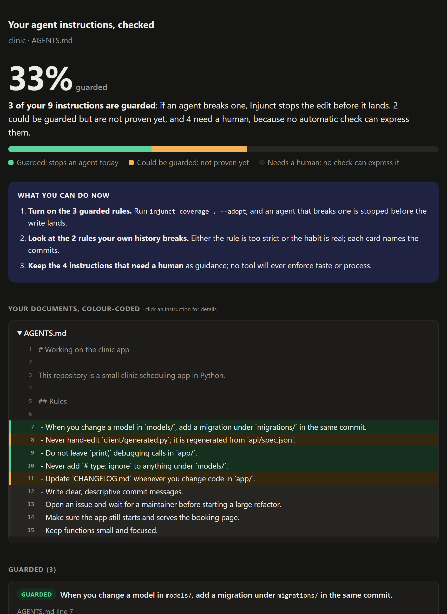

# Injunct

**Your AGENTS.md is a suggestion. Injunct makes it a rule.**

Injunct reads the instructions your repository gives coding agents (AGENTS.md,
CLAUDE.md, CONTRIBUTING.md), works out which of them a machine can actually
check, proves each one against your own git history, and then stops an agent's
edit before it lands when it breaks one: in Claude Code, in opencode, in a git
hook, or on a pull request.

[](LICENSE)


-4285F4.svg)


<p align="center">
  
</p>

## Contents

- [Why](#why)
- [What it does](#what-it-does)
- [Quick start](#quick-start)
- [Use it on your repository](#use-it-on-your-repository)
- [Stop the edit, wherever the agent runs](#stop-the-edit-wherever-the-agent-runs)
- [How it works](#how-it-works)
- [Results](#results)
- [Limitations](#limitations)
- [Configuration](#configuration)
- [Command reference](#command-reference)
- [Development](#development)
- [License](#license)

## Why

Every repository now tells its coding agents what to do, in prose. An agent
reads that prose, mostly follows it, and under pressure skips it, and nobody can
say which instructions are actually enforced and which are wishes. Teams find
out when the migration is missing again.

Prose is the wrong place for a rule a machine could check. Injunct moves those
rules out of the prompt and into a check that runs on the change itself, and is
honest about the ones it cannot move.

## What it does

| | |
|---|---|
| **Measure** | `coverage` sorts every instruction into **guarded** (a check exists and your history proves it), **could be guarded** (a check exists but is not proven yet), or **needs a human** (no check can express it), and says why. One self-contained HTML report, or text, Markdown, JSON and a README badge. |
| **Improve** | `coverage --suggest` proposes a narrower rewrite of vague instructions that *would* be guarded today, each one proven against your history before it is shown. |
| **Enforce** | Proven rules refuse the edit **before it is written**: a Claude Code hook, an opencode plugin, a git pre-commit hook, a GitHub Action that comments on the pull request, or `gate` in any CI. |
| **Look back** | `hindsight` traces each past bug fix to the commit that caused it and reports which of those bugs the rules would have stopped, beside a baseline. |

Three properties hold throughout:

- **A model never decides what blocks.** It only sorts sentences into one of six
  typed checks. Whether a check binds is decided by replaying it against your
  repository's own commits.
- **Nothing a model writes is executed.** Rules are patterns over a diff, never
  generated code.
- **It runs on open weights at no cost.** Gemma 4 through the free Gemini API by
  default, or any OpenAI-compatible endpoint including a local Ollama. The engine
  itself is the Python standard library and one SQLite file.

## Quick start

Requires Python 3.12+ and git.

```bash
pip install git+https://github.com/santoshcheethiralame-dot/INJUNCT
```

See it work in under a minute, offline, with no API key. `--demo` builds a small
sample repository whose history contains three planted mistakes, and replays the
model's recorded answers for it:

```bash
python -m injunct coverage --demo
python -m injunct hindsight --demo
```

```
  33% of the instructions in AGENTS.md are guarded.
  3 guarded   2 could be guarded   4 need a human   (9 instructions)

  3 commit(s) not counted as good work, because a later commit fixed them:
    744e19f: quick debug for the double-booking bug
      fixed by a1650dd Fix stray debug print in booking
  ...
  caught      3/3 (100%) of the commits that introduced a fixed problem,
              counted only where the fix did what the rule asks for
```

## Use it on your repository

Set up a model once (see [Configuration](#configuration)), then run these from
your repository's root:

```bash
python -m injunct coverage . --html coverage.html    # the visual report
python -m injunct coverage . --suggest               # rewrites that would be guarded
python -m injunct coverage . --adopt                 # turn the guarded rules on
python -m injunct hindsight .                        # what they would have caught
```

`coverage` also accepts a public repository by name, for example
`python -m injunct coverage astral-sh/uv`. Answers are cached, so a second run
takes seconds and the number does not drift.

Rules can come from more than your documents:

```bash
python -m injunct init                                  # mine habits from git history
python -m injunct rule "models/*.py needs migrations/"  # state one directly
python -m injunct why models/patient.py                 # what applies to this file
python -m injunct off 4                                 # mute a rule that is wrong
```

## Stop the edit, wherever the agent runs

| Where | Set up | What happens |
|---|---|---|
| **Claude Code** | `python -m injunct claude`, then commit `.claude/` | The edit is denied before it reaches disk. The model receives the full card; you see one line. |
| **opencode** | `python -m injunct opencode` and `python -m injunct serve` | The tool call throws before the write. |
| **git** | `python -m injunct hook` | The pre-commit hook refuses the commit. |
| **GitHub** | copy [`examples/workflows/injunct.yml`](examples/workflows/injunct.yml) | The check fails and the card is posted on the pull request. |
| **Any CI** | `python -m injunct gate .` | Exits 1 when a guarded rule fires. |

What the agent receives when Claude Code refuses an edit:

```
BLOCKED BY INJUNCT - this breaks a rule this repository wrote down, and its history proved it.

  Holding No 1, established 18 Oct 2026. Changing a model requires adding a migration in the same commit.
  Rule:   co_change( models/* -> migrations/* )
  Reason: models/patient.py changed, nothing under migrations/* did
  Tested: held on 14 past commits, 0 false positives.
  From:   AGENTS.md:7
  DO THIS NEXT: create migrations/009_patient.sql
```

And what you see:

> Injunct blocked a write to patient.py: Changing a model requires adding a
> migration in the same commit. (from AGENTS.md:7) Next: create
> migrations/009_patient.sql.

Injunct gates its own pull requests. [PR #1](https://github.com/santoshcheethiralame-dot/INJUNCT/pull/1)
leaves a stray `breakpoint()` in the code; the check fails and the Action posts
the card on the pull request.

**Agent Skills.** [`skills/`](skills/) holds four skills to the Agent Skills open
standard. `injunct` teaches an agent to check the rules before editing, and three
work as one-word commands in Claude Code: `/injunct-check`, `/injunct-coverage`
(opens the visual report) and `/injunct-hindsight`. Install them by copying the
folders into `~/.claude/skills/`.

## How it works

```
 AGENTS.md / CLAUDE.md / CONTRIBUTING.md
        │  candidate sentences, found deterministically
        ▼
 model sorts each one  ──►  one of six typed checks, or a reason it cannot be one
        │
        ▼
 replay against your git history   (commits that a later commit had to fix are left out)
        │
        ├── followed by every past commit      ──►  guarded: blocks today
        ├── broken by a past commit, or untestable ──►  could be guarded
        └── no check can express it            ──►  needs a human
        │
        ▼
 the gate: Claude Code · opencode · git hook · GitHub Action · CI
```

**The six checks** a sentence can become: a file that must change together with
another (`co_change`), a file that must never be edited (`forbidden_edit`), a
pattern no added line may contain (`must_not_appear`), a pattern no removed line
may contain (`must_not_remove`), a pattern every changed file must contain
(`must_appear`), and a command that must have run after a change (`must_run`).

**Proving a rule.** A rule binds only after it is replayed against the
repository's history and stays silent on every past commit that worked. A rule
no past commit could test does not bind either: a check that abstains and a
check that approves look identical from outside, and only one of them is
evidence. A commit that a later commit had to fix is not counted as an example
of good work.

**Beyond your documents,** Injunct ships 25 built-in rules for mistakes agents
make everywhere (committed secrets, leftover debugger breakpoints, destructive
migrations, an agent editing the gate itself), learns habits from your commit
history, and retires a rule in public once enough runs override it and succeed
anyway.

The full design, every check, the built-in rules and the architecture are in
[docs/HOW-IT-WORKS.md](docs/HOW-IT-WORKS.md).

## Results

**Coverage on real repositories** (Gemma 4 26B, 18 Oct 2026):

| Repository | Instructions | Guarded | Could be guarded | Needs a human |
|---|---|---|---|---|
| astral-sh/uv | 63 | **2**: no `#[allow(clippy::…)]` in Rust; no `pull_request_target` in workflows. Both held on 90 commits | 3, two of them already broken by recent commits | 58 (22 process, 15 judgement, 12 runtime, 9 vague) |
| sample repository (`--demo`) | 9 | **3** | 2 | 4 |

On astral-sh/uv, `--suggest` proposes 6 rewrites that would be guarded today,
taking it from **3% to 13%**, each proven on 69 commits.

**Hindsight.** On the sample repository the rules catch all 3 planted bugs,
each by a rule that blocks today, with the fix doing exactly what the rule
asks. On uv's last 300 commits, 21 fixes trace to 7 causes and none is caught
that way, which is the honest answer and the one the tool prints.

**Enforcement, measured.** A 300-run ablation (30 tasks, 3 repositories, 5
seeds) compared the same agent with and without binding rules:

| | Without Injunct | With Injunct |
|---|---|---|
| First-try pass rate | 53.3% | **70.0%** |
| Fell for the same mistake twice | 58.1% | **31.0%** |
| False positives on control tasks | 0.0% | 0.0% |

The extended 410-run suite gives 56.1% → **76.1%** and 57.1% → **19.6%**, and a
6.0% false-positive rate from one known rule. Method, every table, the
compliance sweep and the regressions are in
[docs/BENCHMARKS.md](docs/BENCHMARKS.md).

## Limitations

- **Most agent instructions cannot be enforced.** Process and judgement are
  most of what teams write, and a low coverage number is the finding.
- **Suggested rewrites are proven against history, not intent.** Read each one
  before adopting it.
- **Hindsight is a method, not yet a result** on real repositories.
- **The benchmark agent is synthetic,** and the prose-only arm was not run
  against a real model.
- **When a model call fails,** the instruction is scored as needing a human and
  the output says the number is a floor.

The full list, with how each was found, is in
[docs/LIMITATIONS.md](docs/LIMITATIONS.md).

## Configuration

Only `coverage` and `--suggest` use a model; enforcement never does. Set it
with environment variables:

```bash
export INJUNCT_BASE_URL=https://generativelanguage.googleapis.com/v1beta/openai
export INJUNCT_MODEL=gemma-4-26b-a4b-it
export INJUNCT_API_KEY=...        # a free key from Google AI Studio
```

or with `~/.injunct/provider.json`, which agent apps also read when they do not
inherit your shell's environment. It names the key file instead of holding the
key:

```json
{
  "base_url": "https://generativelanguage.googleapis.com/v1beta/openai",
  "model": "gemma-4-26b-a4b-it",
  "api_key_file": "~/.injunct/gemini.key"
}
```

Any OpenAI-compatible endpoint works the same way. With nothing configured,
Injunct uses a local Ollama at `http://localhost:11434/v1`.

## Command reference

| Command | What it does |
|---|---|
| `coverage [repo]` | how much of the agent documents is guarded. `--html`, `--md`, `--json`, `--badge`, `--suggest`, `--adopt`, `--trust-history`, `--demo` |
| `hindsight [repo]` | which past bugs the rules would have caught, beside a baseline. `--window`, `--no-docs`, `--demo` |
| `init` | learn habits from git history and install the built-in rules |
| `rule "..."` | add a rule in one sentence |
| `confirm <n>` | promote a learned rule so it blocks |
| `why <file>` | the rules that apply to a file, and where each came from |
| `gate [path]` | exit 1 if a guarded rule fires on the working tree. `--plain` prints the text card |
| `off <n>` / `on <n>` | mute or unmute a rule without deleting its history |
| `status` | what was stopped this week |
| `claude` / `opencode` / `hook` | install the Claude Code hook, the opencode plugin, or the git hook |
| `watch` | show every decision live, with any agent or editor |
| `serve` | local HTTP interface for agent runtimes |
| `docket`, `sweep`, `reject`, `dump` | inspect and maintain the rule ledger |
| `board`, `demo`, `bench`, `live`, `replay` | the visual board, the split-screen demo, and the benchmark |

Every command is `python -m injunct <command>`. If your Python scripts folder is
on `PATH`, `injunct <command>` works too.

## Development

```bash
git clone https://github.com/santoshcheethiralame-dot/INJUNCT
cd INJUNCT
pip install -e .
python -m pytest -q
```

The suite needs no network and no API key. Design notes for contributors are in
[CLAUDE.md](CLAUDE.md), and the five-minute presentation run sheet is
[docs/HACKDAY-DEMO.md](docs/HACKDAY-DEMO.md).

## License

[MIT](LICENSE).
