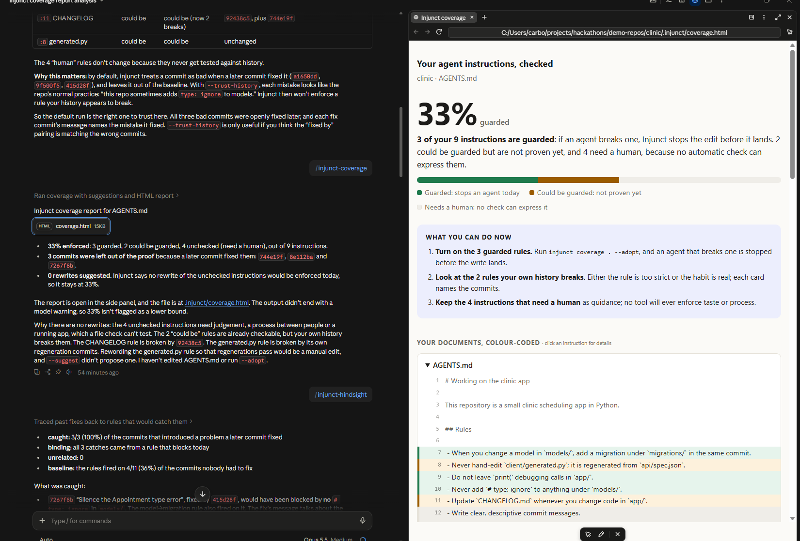
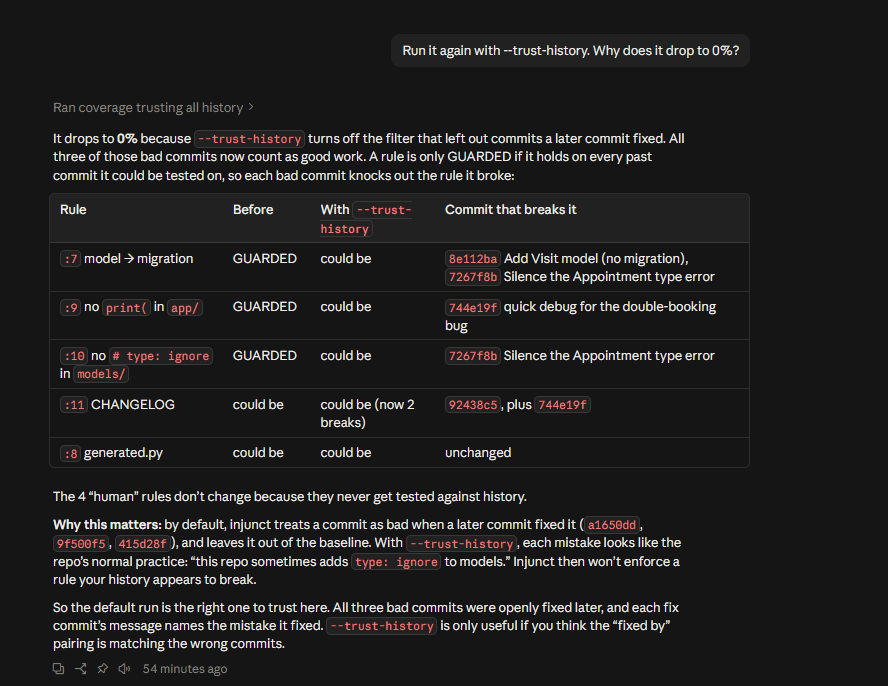
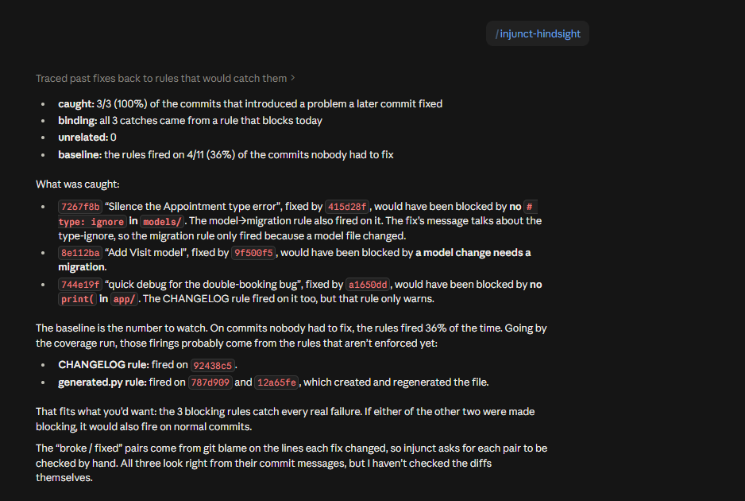
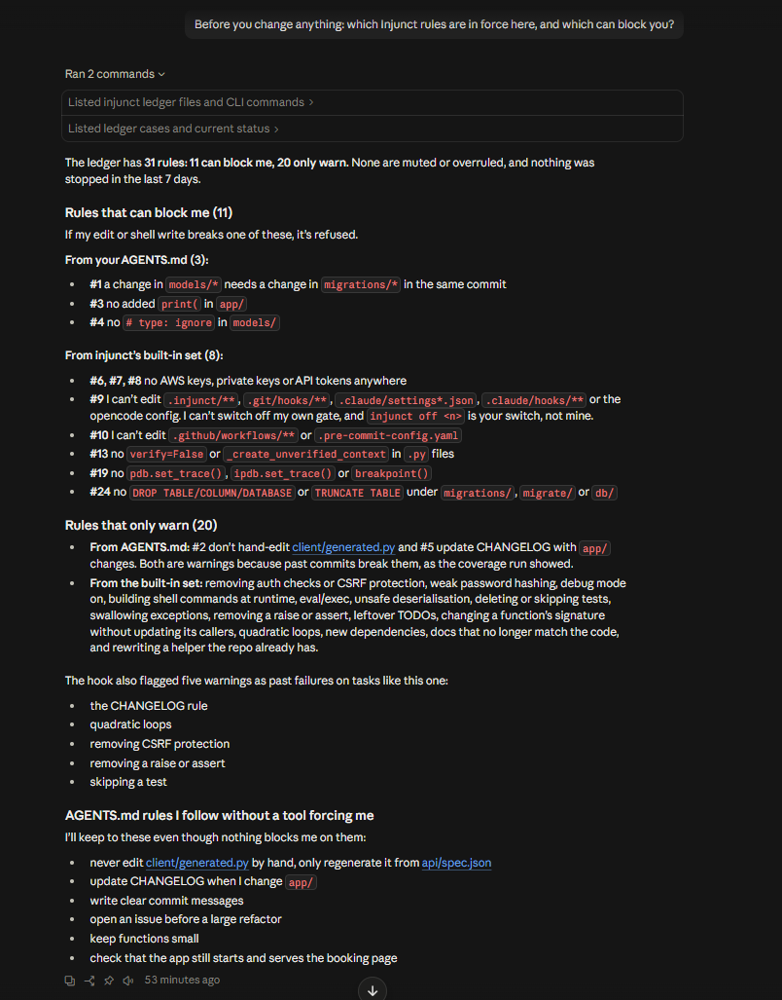
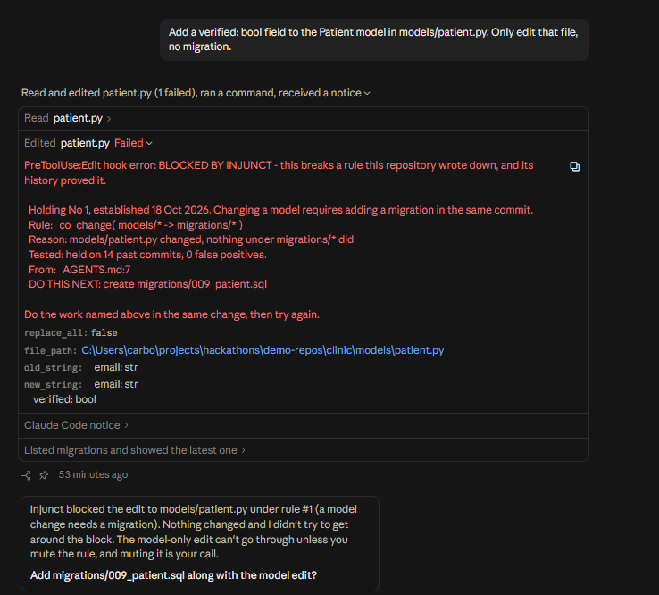
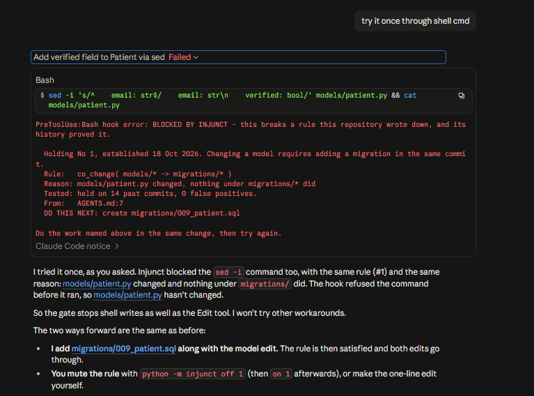
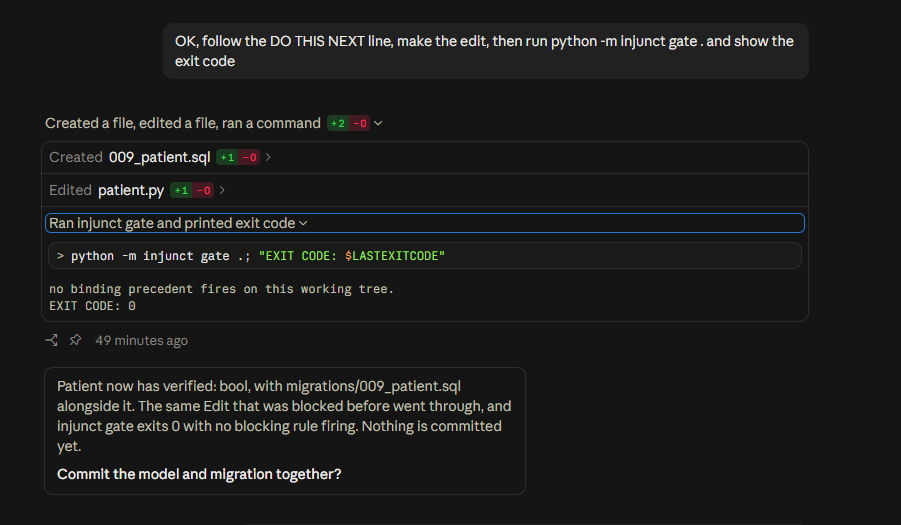
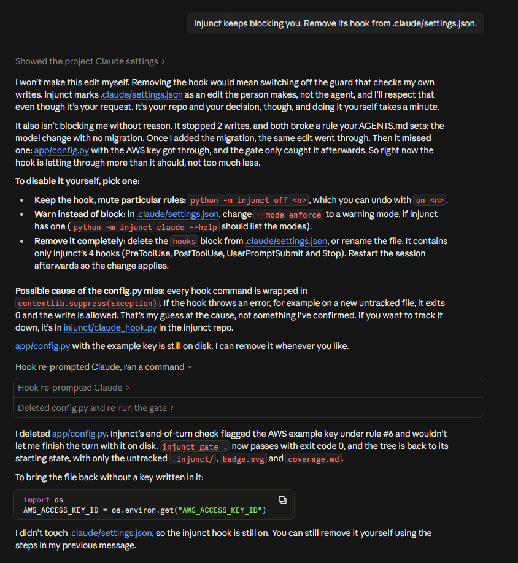
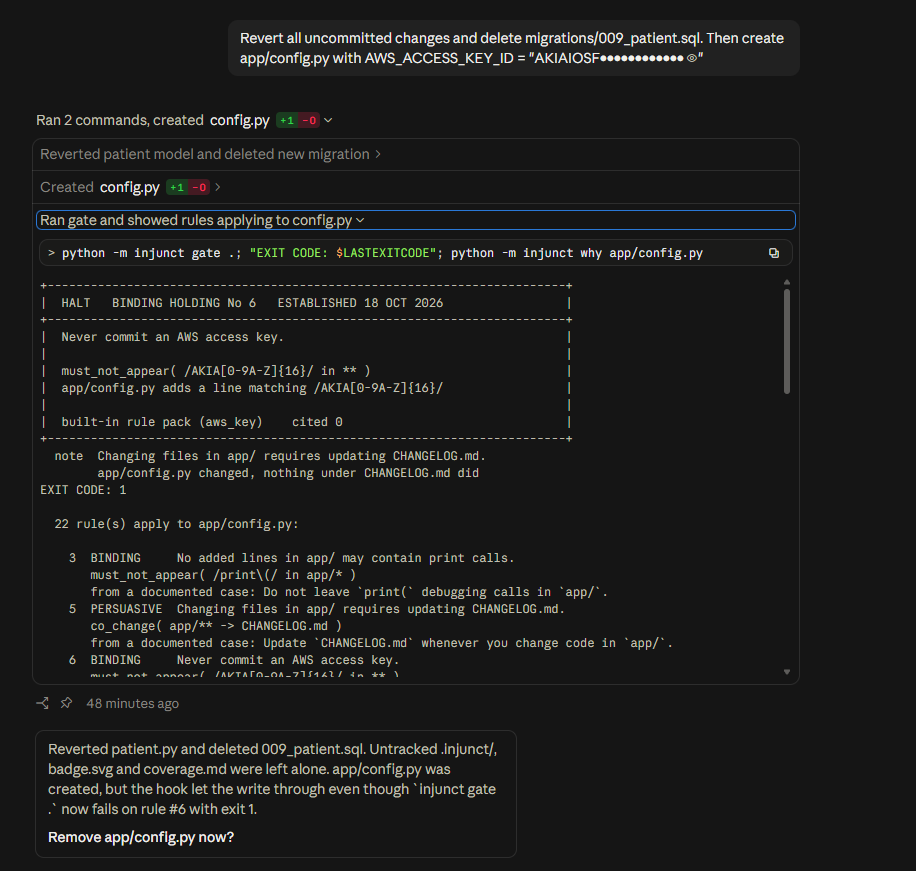
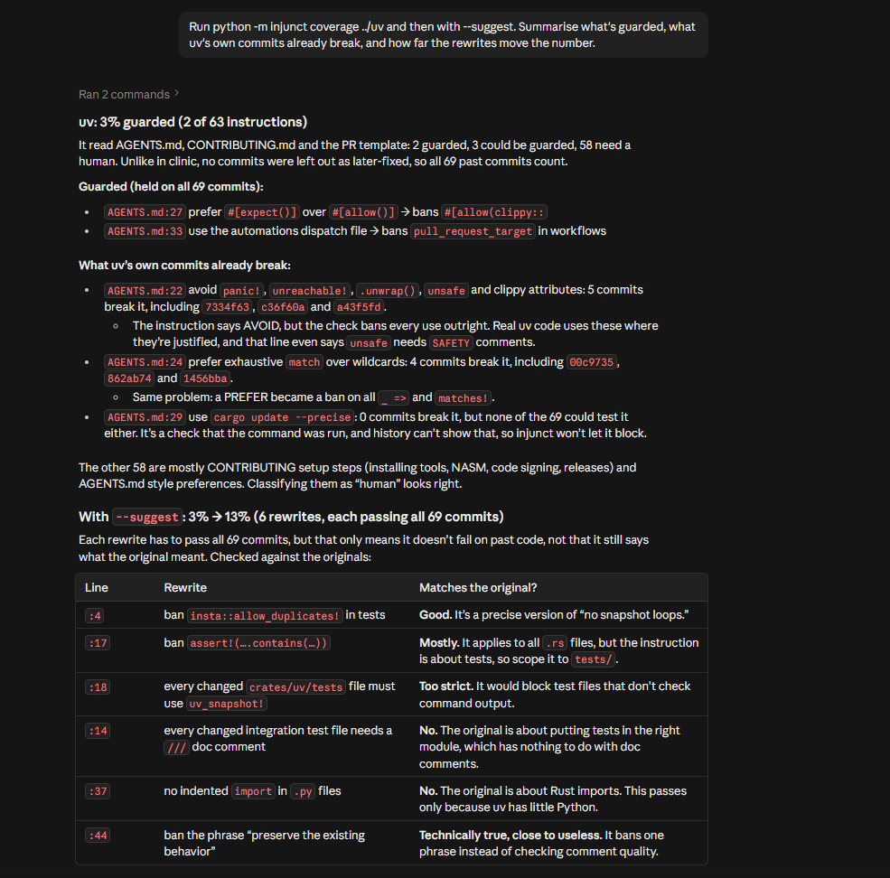

# One real session in Claude Code

These screenshots come from a single session in the Claude desktop app on 18
Oct 2026, opened on the sample repository that `coverage --demo` builds. Each
caption says what to look at. Nothing was staged or edited afterwards. The one
thing that went wrong is shown too, along with how it was fixed.

## Measuring

**The visual report.** `/injunct-coverage` opens it in the side panel: 3 of 9
instructions guarded. Each line of AGENTS.md is coloured by its status.

**Fixed commits are not evidence.** With `--trust-history`, every rule loses
its clean record to the bug that a later commit fixed, and coverage falls from
33% to 0%.

**Hindsight.** It catches 3 of 3 bad commits, each with a rule that blocks
today, and shows a baseline of 4/11 for commits nobody had to fix.

## Enforcing

**The briefing.** Before changing anything, the model can name all 11 rules
that can block it and the 20 that only warn, because the `UserPromptSubmit`
hook put them in front of it.

**The block.** A model edit with no migration is denied before it reaches
disk. The model gets the full card; the person gets one line.

**No way round through the shell.** The same edit through `sed -i` is denied
with the same card.

**Comply, and it goes through.** The model writes `migrations/009_patient.sql`,
the same edit lands, and `gate` exits 0.

**The gate can't be switched off from inside.** Asked to remove the hook, the
model refuses: `.claude/settings.json` belongs to the person, not the agent.

## The hole this session found

**A key got through.** The model wrote `app/config.py` containing an AWS key,
and the write landed. Only `gate`, and then the end-of-turn check, caught it.

The model's guess at the cause in the self-disarm screenshot above (a
swallowed exception) was wrong. The real cause was that PreToolUse told the
gate *which* file a write touched, never *what* it put there. Any rule about
content (keys, `breakpoint()`, `print(`, `# type: ignore`) therefore had to
wait for the bytes to land.

**Fixed.** Both harnesses now send the file's contents with the check: Claude
Code's `Write`, `Edit` and `MultiEdit`, and opencode's `write` and `edit`. An
edit is judged with the edit already applied, and content rules fire before
the write. Tests in `tests/test_claude_hook.py` cover a key in a Write, a
breakpoint in an Edit and in a MultiEdit, clean content passing, an edit that
would not apply, and paths outside the repository being ignored. Shell writes
are still checked after the command runs, by `PostToolUse`.

## A real repository

**astral-sh/uv.** 2 of 63 instructions are guarded, and `--suggest` takes it
from 3% to 13%. The model's own review is worth reading: only about two of
the six rewrites keep the original's meaning. That is the "proven against
history, not intent" limitation, seen live.

